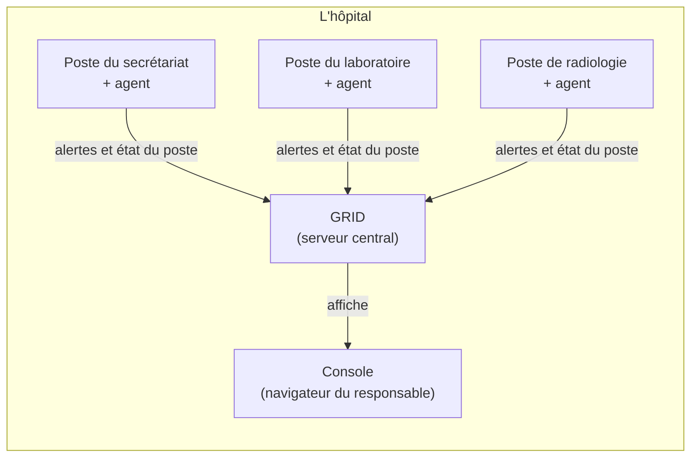
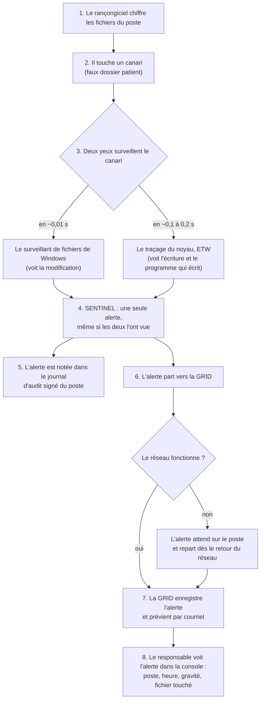
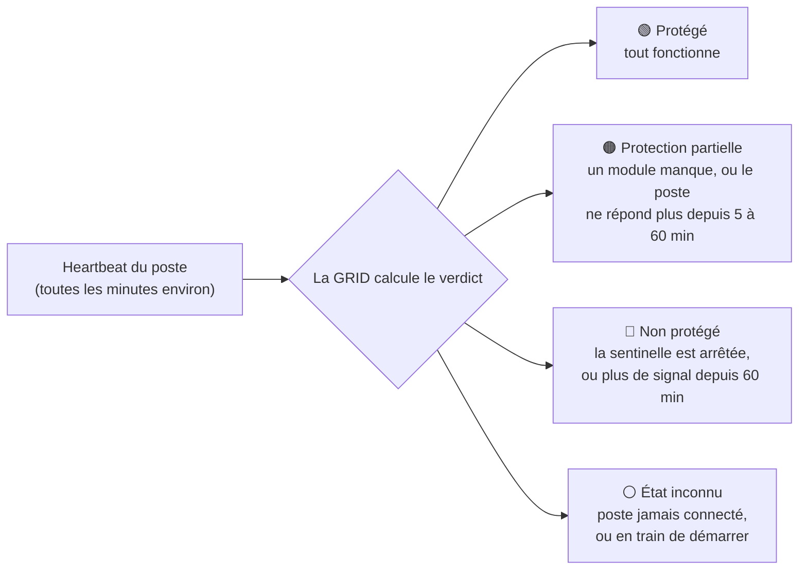
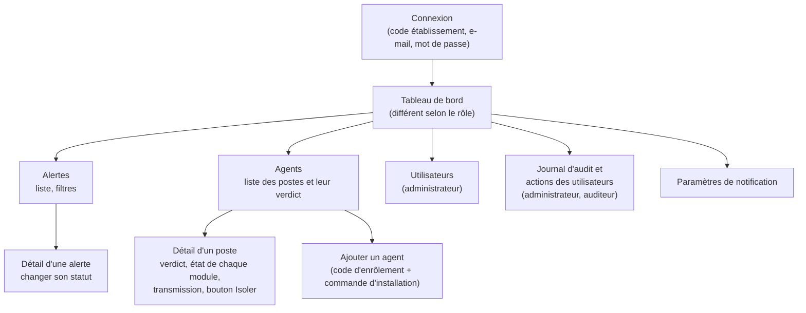

# Comment ça marche — RansomGuard-CM expliqué simplement

Ce document explique ce que fait RansomGuard-CM, du début à la fin, sans connaissances techniques préalables. Chaque mot technique est expliqué la première fois qu'il apparaît. Pour l'historique détaillé du projet (qui a fait quoi, quand, avec quel commit), voir le [journal des actions](JOURNAL_DES_ACTIONS.md).

État décrit : octobre 2026 (branche `sprint8/recovery`).

---

## 1. Le problème

Un **rançongiciel** est un programme malveillant qui chiffre les fichiers d'un ordinateur. **Chiffrer**, c'est brouiller le contenu d'un fichier pour le rendre illisible sans une clé secrète. L'attaquant exige ensuite une rançon pour donner la clé. Dans un hôpital, cela veut dire des dossiers de patients, des résultats d'analyses et des images médicales devenus inutilisables.

RansomGuard-CM a deux missions : **voir l'attaque le plus tôt possible**, et à terme **l'arrêter**. Aujourd'hui, il sait la voir et prévenir ; il ne sait pas encore l'arrêter (voir la section 5).

---

## 2. Les trois pièces du produit

| Pièce | Ce que c'est | Où elle tourne |
|---|---|---|
| **L'agent** | Un programme qui surveille un ordinateur. Il fonctionne en **service Windows**, c'est-à-dire un programme qui démarre avec l'ordinateur et tourne en arrière-plan, sans fenêtre. | Sur chaque poste de l'hôpital (secrétariat, laboratoire, radiologie…) |
| **La GRID** | Le **serveur central**, un ordinateur qui reçoit les informations de tous les agents et les garde. | Sur un serveur de l'hôpital |
| **La console** | Le site web que les responsables ouvrent dans leur navigateur pour voir les alertes et l'état des postes. | Dans le navigateur, servie par la GRID |



Les échanges entre les postes, le serveur et la console sont **chiffrés** (protocole HTTPS, le même que celui des sites bancaires) : personne ne peut les lire en route.

---

## 3. Ce que surveille l'agent

L'agent est composé de plusieurs **modules**. Chaque module surveille une chose précise.

| Module | Ce qu'il surveille, en une phrase | Ce qu'il fait aujourd'hui |
|---|---|---|
| **SENTINEL** (la sentinelle) | Il dépose des **fichiers pièges**, appelés **canaris** : de faux dossiers de patients que personne n'a de raison d'ouvrir. Un rançongiciel, lui, chiffre tout ce qu'il trouve. Si un canari est modifié, renommé ou supprimé, c'est une attaque. | Il détecte et lève une alerte critique. |
| **ENTROPY** | L'**entropie** mesure à quel point le contenu d'un fichier ressemble à du bruit. Un fichier chiffré a une entropie très élevée. ENTROPY repère les fichiers qui deviennent soudain « du bruit ». | Il détecte et lève une alerte. |
| **USB GUARD** | Les clés USB branchées : il vérifie le contenu et compare la clé à une liste de clés autorisées. | Il détecte et lève une alerte, mais ne bloque pas encore la clé. |
| **EXFIL WATCH** | Le réseau : il repère un programme qui envoie beaucoup de données vers l'extérieur (**exfiltration**, c'est-à-dire un vol de données avant le chiffrement). | Il détecte, et il peut freiner le programme ou bloquer l'adresse visée. |
| **GENEALOGY** | La **généalogie des processus** : un **processus** est un programme en train de tourner. GENEALOGY retrouve quel programme a lancé quel autre, pour comprendre d'où vient l'attaque. | Il fonctionne, mais il dépend de l'**attribution** (savoir quel programme a touché le fichier), qui n'est pas encore fiable. |
| **IRONCLAD** | Il doit couper électriquement un port USB au moyen d'un petit boîtier électronique (Arduino). | Il fonctionne seulement en simulation, sans le boîtier réel. Il est désactivé par défaut. |
| **ANTI_TAMPERING** | Il doit protéger l'agent contre un attaquant qui essaierait de l'arrêter. | Pas encore en service. |

Tout ce que fait l'agent est noté dans un **journal d'audit signé**. Chaque ligne y est scellée par une **signature électronique** : si quelqu'un modifiait une ligne après coup, cela se verrait.

---

## 4. Le parcours d'une attaque, du fichier piège jusqu'à la console

Prenons le cas le plus important : un rançongiciel commence à chiffrer les fichiers d'un poste et touche un canari.



Quelques mots de ce schéma :
- **Le surveillant de fichiers de Windows** (« FileSystemWatcher ») : un service de Windows qui prévient quand un fichier change. Il est très rapide, mais il ne dit pas quel programme a fait le changement. Il ne voit pas non plus certaines écritures, comme une réécriture « par fichier mappé », une technique qu'emploient certains rançongiciels.
- **ETW** (*Event Tracing for Windows*) : le journal de bord interne de Windows, au niveau du **noyau** (le cœur du système). Il voit chaque écriture et le numéro du programme qui l'a faite. Il demande des droits d'administrateur. Il est branché depuis octobre 2026 ; l'identification du programme coupable est en cours de finition (section 6).
- Si le réseau est coupé, l'alerte n'est pas perdue : l'agent la garde et la renvoie automatiquement, tout seul. Cela a été vérifié lors de la démonstration du 15 octobre 2026.

### Et pendant ce temps : « est-ce que ce poste est protégé ? »

Toutes les minutes environ, chaque agent envoie un **heartbeat**, littéralement un « battement de cœur » : un court message qui dit « je suis là » et donne l'état de chacun de ses modules. La GRID en déduit un **verdict**, affiché en couleur dans la console :



Le verdict dit toujours **pourquoi**, en une phrase. Par exemple : « Protection partielle — EXFIL WATCH inactif : droits administrateur manquants ».

---

## 5. Les écrans de la console

La console a trois profils d'utilisateurs, appelés **rôles** :
- **Administrateur** : il voit tout et gère tout ;
- **Analyste** : il suit et traite les alertes ;
- **Auditeur** : il consulte, sans rien modifier.



| Écran | À quoi il sert | Qui le voit |
|---|---|---|
| **Connexion** | Entrer avec le code de l'établissement, son e-mail et son mot de passe. Sans activité pendant 30 min, la session se ferme d'elle-même. | Tous |
| **Tableau de bord** | La vue d'ensemble : alertes du moment, postes protégés ou non. Une version par rôle. | Tous |
| **Alertes** | La liste des alertes, avec leur gravité, le poste concerné et le module qui l'a levée. Le détail d'une alerte permet de la marquer « en cours d'examen », « résolue » ou « fausse alerte ». | Tous ; seuls l'administrateur et l'analyste changent un statut |
| **Agents** | La liste des postes et leur verdict de couleur. Le **détail d'un poste** donne la phrase du verdict, l'état de chaque module (avec la raison quand il ne fonctionne pas), et l'état de la transmission : alertes en attente, dernière transmission réussie. Pendant une coupure, ces valeurs sont marquées « dernière valeur reçue à HH:MM », pour ne pas les faire passer pour des valeurs actuelles. | Tous |
| **Ajouter un agent** | Donne un **code d'enrôlement** (valable 30 min) et la commande d'installation à lancer sur le poste. L'**enrôlement**, c'est l'inscription du poste auprès de la GRID. | Administrateur |
| **Isoler un poste** | Demande de couper le poste du réseau. **La demande est enregistrée, mais aucun agent ne l'exécute encore.** | Administrateur |
| **Utilisateurs** | Créer, désactiver ou réactiver des comptes, et changer les rôles. | Administrateur |
| **Journal d'audit** | Ce que les agents ont fait et ce que les utilisateurs ont fait dans la console : qui, quoi, quand. | Administrateur, auditeur |
| **Notifications** | Choisir quelles alertes envoient un courriel. | Tous |

### Voir la console sur ce poste

L'environnement de démonstration local s'appelle **grid-local**. Les identifiants de démonstration se trouvent dans `C:\Users\Fabiola\grid-local\demo-credentials.txt`, un fichier qui n'est jamais versionné.

- **Console de la GRID locale** : https://localhost:8443 . Le navigateur affiche un avertissement de certificat, expliqué ci-dessous.
- **Console de développement**, sans avertissement de certificat, depuis PowerShell :
  ```powershell
  cd C:\Users\Fabiola\source\repos\ransomguard-cm\dashboard
  $env:VITE_PROXY_TARGET = 'https://localhost:8443'
  npx vite --port 5174
  ```
  puis ouvrir http://localhost:5174 . **La variable `VITE_PROXY_TARGET` est indispensable** : sans elle, la console de développement envoie ses requêtes à l'ancien serveur de juillet (dette OPS-001), pas à la GRID locale.

**Pourquoi l'avertissement de certificat.** Un **certificat** est la carte d'identité d'un site web. Celui de la GRID locale est délivré par une **autorité de démonstration** créée sur ce poste, que Windows ne connaît pas : le navigateur le signale. On ne réinstalle pas cette autorité dans Windows, parce que Windows ferait alors confiance à tout ce qu'elle signe, pour tous les sites, et que sa clé est un simple fichier sur ce poste. Le propriétaire a décidé qu'elle ne resterait jamais installée.

---

## 6. Ce qui est fait, et ce qui ne l'est pas encore

```mermaid
flowchart LR
    subgraph Fait["✅ Fait et vérifié"]
        F1["Détection par les canaris,<br/>l'entropie, l'USB, le réseau"]
        F2["Alerte jusqu'à la console,<br/>même après une coupure réseau"]
        F3["Verdict de protection<br/>par poste, avec la raison"]
        F4["Journal d'audit signé,<br/>sans perte sous forte charge"]
        F5["Console : alertes, postes,<br/>utilisateurs, audit, rôles"]
        F6["Traçage noyau ETW branché<br/>dans la sentinelle"]
    end
    subgraph EnCours["🔧 En cours"]
        E1["Désigner le programme coupable<br/>(attribution ETW : étapes 4 à 8 sur 8)"]
    end
    subgraph AFaire["⏳ Pas encore fait"]
        A1["Arrêter l'attaque :<br/>suspendre le programme, isoler le poste"]
        A2["Bloquer réellement<br/>une clé USB"]
        A3["IRONCLAD avec le vrai boîtier,<br/>et la sauvegarde isolée prévue"]
        A4["Double authentification (MFA)<br/>pour la console"]
        A5["Installateur signé (setup.exe),<br/>enrôlement sans manipulation"]
        A6["Protection de l'agent contre<br/>sa propre neutralisation"]
    end
    Fait --> EnCours --> AFaire
```



| Sujet | Où on en est, en clair |
|---|---|
| **Désigner le programme coupable** | La sentinelle voit l'attaque, mais aujourd'hui elle ne sait pas dire quel programme l'a faite (0 bonne réponse sur 60 essais de type rançongiciel). Le traçage noyau ETW, qui porte ce renseignement, est branché depuis le 21 octobre. Les étapes restantes : l'attribution elle-même, son affichage dans la console, le fonctionnement de secours, l'état du module, puis la mesure finale. |
| **Arrêter l'attaque** | Rien ne suspend encore un programme ni n'isole un poste. Le bouton « Isoler » enregistre la demande, mais l'agent ne l'exécute pas. C'est la suite prévue, une fois que l'on sait désigner le bon programme : suspendre un innocent serait pire que de ne rien faire. |
| **Bloquer une clé USB** | USB GUARD détecte et prévient, mais il ne bloque pas : il le dit lui-même, par l'état « dégradé : blocage non implémenté ». |
| **IRONCLAD** | Il ne fonctionne qu'en simulation. Le pilotage du vrai boîtier n'est pas écrit, et la sauvegarde isolée prévue dans la conception n'a pas encore de code. |
| **Double authentification (MFA)** | La **MFA** demande, en plus du mot de passe, un code à usage unique (par exemple sur un téléphone). Elle est décidée pour les administrateurs, mais pas encore développée. |
| **Installation** | Aujourd'hui, il faut installer à la main l'autorité de certification de la GRID sur chaque poste, puis lancer un script en administrateur. Un installateur signé est prévu plus tard. |
| **Windows 7** | Il n'est pas pris en charge : l'agent repose sur une technologie qui exclut Windows 7. La documentation commerciale ne le promet plus. |
| **Ancien serveur de juillet** | Un serveur déployé en juillet tourne encore avec l'ancien code. Ses clés sont à considérer comme exposées. La décision appartient au propriétaire (dette OPS-001). |

---

## 7. Petit lexique

| Mot | Sens |
|---|---|
| Agent | Programme de surveillance installé sur chaque poste. |
| Alerte | Message qui signale une activité suspecte, avec sa gravité. |
| Attribution | Le fait de désigner le programme responsable d'une action. |
| Audit (journal d') | Registre de tout ce qui s'est passé, signé pour ne pas pouvoir être falsifié. |
| Canari | Fichier piège imitant un vrai dossier, que personne ne devrait toucher. |
| Certificat | Carte d'identité numérique d'un serveur, qui permet au navigateur de vérifier à qui il parle. |
| Chiffrer | Rendre un fichier illisible sans une clé secrète. |
| Console | Le site web de supervision, pour les responsables. |
| Enrôlement | L'inscription d'un poste auprès du serveur central. |
| ETW | Le journal de bord interne de Windows, qui voit chaque écriture de fichier et le programme qui l'a faite. |
| GRID | Le serveur central de l'hôpital. |
| Heartbeat | Le message régulier « je suis là, voici mon état » qu'envoie chaque agent. |
| MFA | Double authentification : un mot de passe plus un code à usage unique. |
| Processus | Un programme en train de tourner. |
| Rançongiciel | Programme malveillant qui chiffre les fichiers et réclame une rançon. |
| Service Windows | Programme qui démarre avec l'ordinateur et tourne en arrière-plan. |
| Verdict | L'état de protection d'un poste, en couleur, avec sa raison. |
