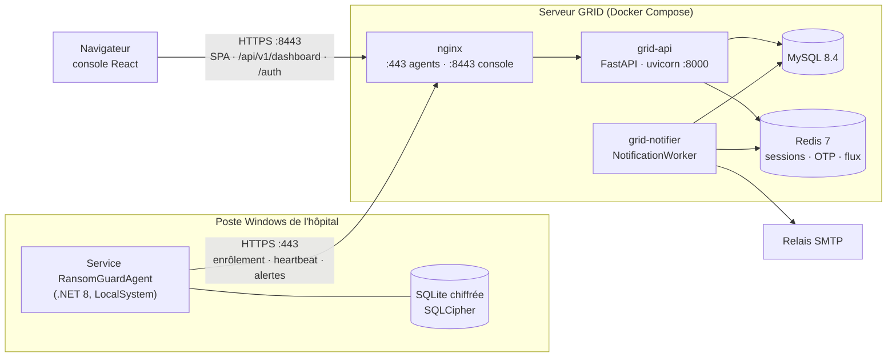
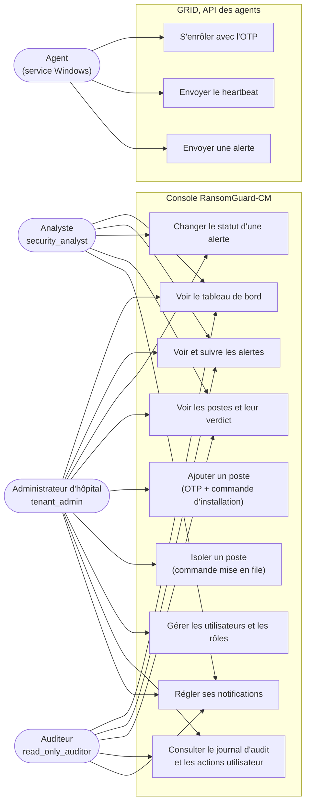
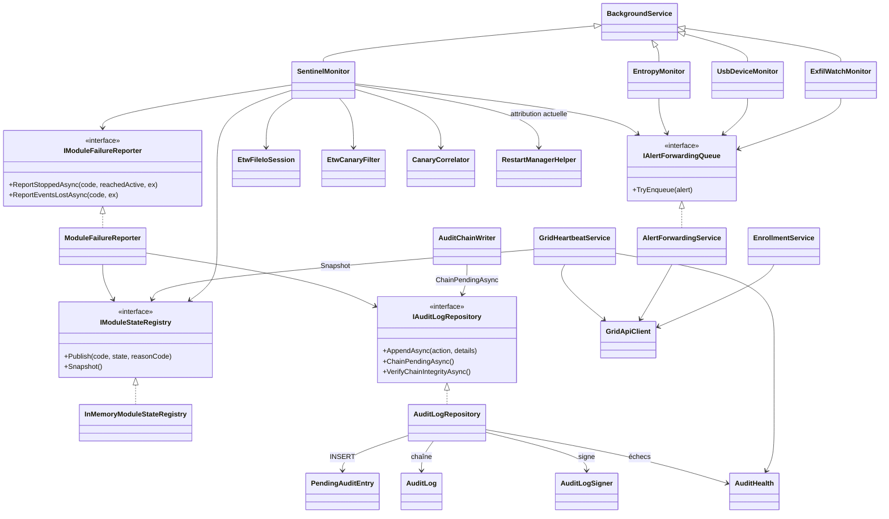
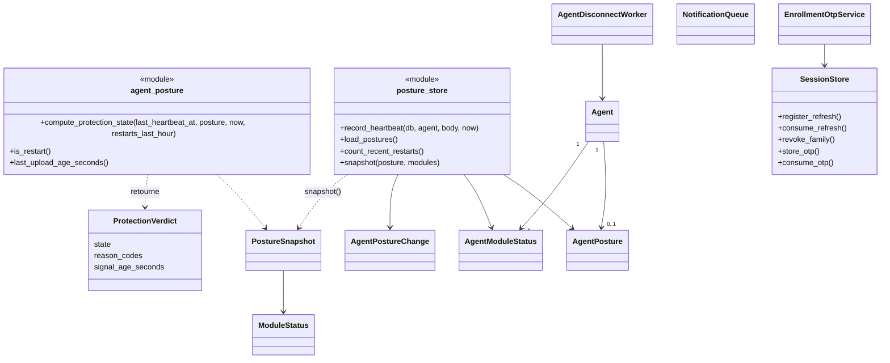
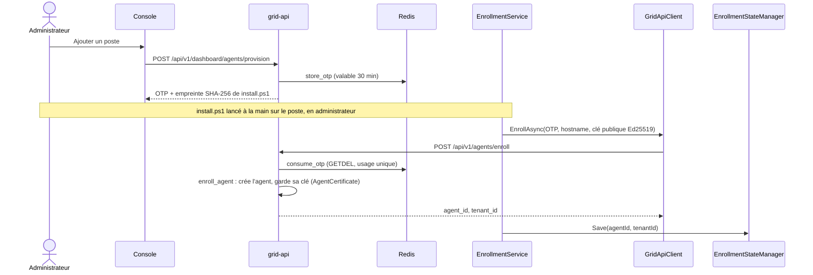
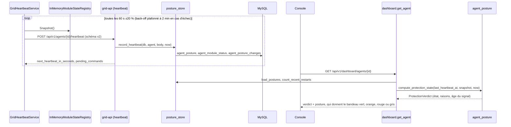
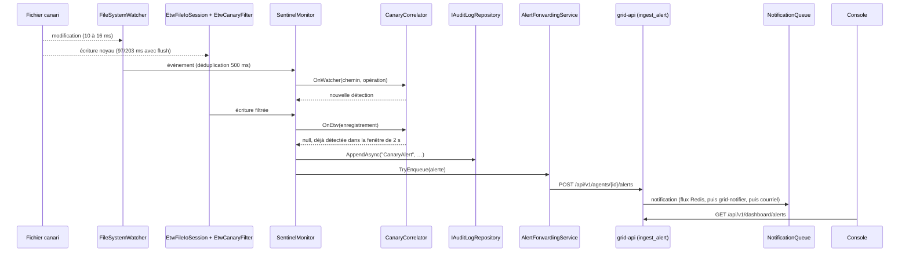
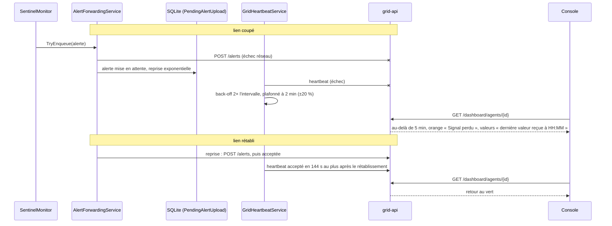
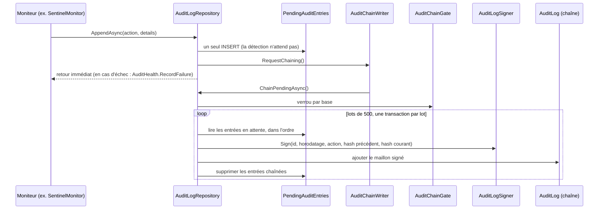

# Journal des actions — RansomGuard-CM

Ce journal retrace ce qui a **réellement** été fait sur le projet, sprint par sprint. Il est établi à partir de l'historique git (`git log`, corps des commits, tags) et des rapports et cadrages récupérés après la perte du disque (`RECUPERATION_SPRINT8`). Rien n'y est inventé : quand un détail manque, il est écrit « non retrouvé ».

- **État décrit** : branche `sprint8/recovery` au commit `ede6e0f` (2026-10-21).
- **Mise à jour** : à chaque lot terminé.
- **Lecture** : les SHA sont des préfixes de commits git (`git show <sha>`). Les identifiants de défauts (AGT-…, GRID-SEC-…, GRID-PST-…, OPS-…) renvoient aux tables de dette de `agent/README.md`, `grid/README.md` et `docs/deployment/GRID_SERVER_RUNBOOK.md`.

> **À ne pas prendre comme source** : le `CHANGELOG.md` de la racine a été écrit d'un coup le 2026-06-22 (`3c89a27`). Ses dates et son contenu pour les Sprints 1 à 6 contredisent git et les rapports : par exemple, il date le Sprint 1 du 2026-03-15 alors que l'historique commence le 2026-05-15, et il décrit IRONCLAD comme un module de sauvegarde. Seule son entrée 0.9.0 (Sprint 7) concorde avec les commits.

---

## Sommaire

1. [Le produit en une page](#1-le-produit-en-une-page)
2. [Chronologie](#2-chronologie)
3. [Tableaux d'explication](#3-tableaux-dexplication)
4. [Diagrammes](#4-diagrammes)
5. [Ce qui n'est pas encore fait](#5-ce-qui-nest-pas-encore-fait)
6. [Non retrouvé](#6-non-retrouvé)

---

## 1. Le produit en une page

RansomGuard-CM protège contre les rançongiciels les postes Windows des hôpitaux d'Afrique francophone. Il comprend trois parties :

- **L'agent**, un service Windows .NET 8 installé sur chaque poste. Il surveille les fichiers pièges (canaris), l'entropie des écritures, les clés USB et le réseau. Il écrit un journal d'audit signé, envoie ses alertes et un heartbeat (sa posture) au serveur.
- **La GRID**, le serveur central de l'hôpital (FastAPI, MySQL, Redis, nginx, sous Docker). Elle reçoit les alertes et les heartbeats, calcule pour chaque poste un verdict de protection et sert la console.
- **La console**, une application web React pour les opérateurs de l'hôpital. Elle affiche les alertes, les postes et leur verdict, les utilisateurs et le journal d'audit.

---

## 2. Chronologie

### Avant le Sprint 1 — architecture et preuve de concept (2026-05-15 → 05-17)

| Étape | Ce qui a été fait, et pourquoi | SHA | Tests | Défauts |
|---|---|---|---|---|
| Architecture | Le monorepo (agent, server, cloud, dashboard, shared) et la documentation : PR/FAQ, design doc, C4, flux, schéma de base, OpenAPI, SLO, runbook. Fin de la phase « architecture technique ». Tag `v0.1.0-architecture`. | `2287e57`, `50396b6` | — | — |
| Squelette de l'agent | Solution C# .NET 8 en trois projets : Service, Core, Tests. | `cdbd619` | — | — |
| Preuve de concept 1 | La détection par FileSystemWatcher est validée : 414 événements captés sans perte, environ 10 ms, CPU 0 %, RAM 199,88 Mo. Tag `v0.2.0-hypothesis1-validated`. | `a6b7606` | — | Limites notées : doublons d'événements, risque de pertes sous charge |

### Sprint 1 — socle de l'agent (2026-05-17, tag `v0.3.0-foundation`)

| Étape | Ce qui a été fait, et pourquoi | SHA | Tests | Défauts |
|---|---|---|---|---|
| Standards | `.editorconfig`, `.gitattributes`, réglages VS Code. | `112ae10` | — | — |
| Configuration | Configuration typée, validée au démarrage par FluentValidation, pour échouer tôt. | `eacf5c8` | 45 annoncés | — |
| Journalisation | Serilog structuré vers console, fichier et EventLog, 30 jours de rétention. | `d4dad84` | — | — |
| Persistance | SQLite et EF Core, 4 entités dont un AuditLog chaîné par hash. Canal borné pour ne pas bloquer le watcher. | `a61aaab` | 67 au total | — |
| Service Windows | Installation en service, redémarrage automatique en cas d'échec, scripts PowerShell. | `af32965` | — | — |
| Rapport | `SPRINT_1_REPORT.md`. | `3115fbc` | 67 | Dette déclarée : `EnsureCreated` au lieu de migrations, licence FluentAssertions, pas de déduplication, `DropOldest`, pas de tests d'intégration |

### Sprint 1.5 — dette (2026-05-18, tag `v0.3.1-debt-cleanup`)

| Étape | Ce qui a été fait, et pourquoi | SHA | Tests |
|---|---|---|---|
| Migrations | `EnsureCreated` remplacé par `Database.Migrate()`, pour faire évoluer le schéma sans supprimer la base. | `4c7cd0c` | +3 |
| Déduplication | `FileEventDeduplicator`, fenêtre de 500 ms : le watcher émettait 2 à 4 fois chaque événement. | `9f2d3d3` | +9 |
| Shouldly | FluentAssertions 8, sous licence commerciale, est remplacé par Shouldly (MIT). Décision **ADR-016**. | `172ffea` | 79 au total |

### Sprint 2 — SENTINEL, les canaris médicaux (2026-05-18, tag `v0.4.0-sentinel`)

| Étape | Ce qui a été fait, et pourquoi | SHA | Tests | Défauts |
|---|---|---|---|---|
| Entités | `SentinelOptions`, `SentinelCanary`, `CanaryAlert`, et leur migration. | `6305074` | +16 | — |
| Contenu | 5 modèles médicaux en français, empreinte SHA-256. Le commit annonce « French/English ». | `0210d52` | +22 | L'audit établit que seul le français existe |
| Déploiement | `SentinelDeploymentService` dépose les canaris au démarrage, de façon idempotente. | `33a2588` | +6 | — |
| Surveillance | `SentinelMonitor` : watcher, scrutation périodique et alerte critique écrite dans l'audit. | `e2748e9` | +6 | — |
| Clôture | 3 scénarios de bout en bout, `docs/modules/sentinel.md`. | `0be6b92` | 132 | — |
| Audit senior | `SPRINT_2_AUDIT.md`, verdict « CONDITIONALLY PASS ». | `98cd9a2` | — | L'attribution de processus était du code mort (P1) ; régénération au démarrage seulement ; canaris visibles ; `async void` ; `.txt` seulement ; fuite de handles |

### Sprints 2.5 et 2.5-B — durcissement de SENTINEL (2026-05-18, tags `v0.4.1` à `v0.4.3`)

| Étape | Ce qui a été fait, et pourquoi | SHA | Tests | Défauts |
|---|---|---|---|---|
| Attribution | Restart Manager en P/Invoke, objets `Process` libérés. | `dcd4e05` | — | Corrige le code mort de l'audit, CWE-401 |
| Régénération | Canal à la place d'`async void`, régénération en temps réel avec garde anti-boucle, canaris Hidden et System. | `a630af4` | +4 | CWE-404, CWE-732 |
| Canaris .docx | Fichiers OpenXML valides, parce que les rançongiciels évolués ignorent les `.txt`. | `77c09f1` | +7 | — |
| Chemins, journaux, secrets | `PathValidator`, `LogRedactionEnricher`, audit des secrets (aucun trouvé). | `82f5f59` | 161 au total | CWE-22, 23, 73, 200, 532 |
| Base chiffrée | SQLCipher AES-256, clé protégée par DPAPI (loi camerounaise 2024/017). | `5a1d3a6` | — | CWE-311, 312 |
| Service protégé | Descripteur de sécurité du service, STRIDE SENTINEL, **ADR-017**. | `6590f69` | — | — |
| Audit signé | Ed25519 via NSec, clé protégée par DPAPI. | `d74a26a` | +8 | — |
| DACL | `DaclEnforcer` : SYSTEM et Administrateurs seulement. | `1a86edb` | +6 | CWE-732 |
| Auto-intégrité | Fichier `.sha256` compagnon, comparaison en temps constant. | `c85254c` | +4 | CWE-208 |
| Formats | Canaris `.pdf`, `.jpg`, `.xlsx`. | `7cdb085` | +13 | 192 au total |
| Chaîne d'approvisionnement | SBOM CycloneDX, Roslynator, deux dépendances transitives « high » corrigées. | `fbfb609`, `b59cdcf`, `40da599` | — | GHSA-7jgj-8wvc-jh57, GHSA-cmhx-cq75-c4mj |

### Sprint 3 — ENTROPY et GENEALOGY (2026-05-18 → 05-19, tag `v0.5.1-zero-debt`)

| Étape | Ce qui a été fait, et pourquoi | SHA | Tests |
|---|---|---|---|
| Entropie | Entropie de Shannon en flux, échantillonnée au-delà de 1 Mo. | `b36f956` | +12 |
| Détecteur | 4 règles : seuil, écart à la référence, bascule de répertoire, liste blanche. | `ec11588` | +12 |
| Surveillance | `EntropyMonitor`, canal de 10 000 éléments, canaris ignorés. | `706844f` | +3 |
| Arbre de processus | Reconstruction par WMI, motifs MITRE. | `b33f3ce` | +12 |
| Enrichissement | `GenealogyEnricher` : passer de « quelque chose s'est passé » à « ce processus l'a fait ». | `c4978e1` | 231 au total |
| Conformité | Règles séparées, référence à débit limité, 7 motifs MITRE sur 7, STRIDE. | `bdfcb0e`, `f042c78` | 259 au total |
| Portes de validation | Mesures SLO (RAM 155,75 Mo), simulation de rançongiciel, commande `--verify-audit-log`. | `cb3ccbb` | 278 au total |
| Zéro dette | 8 manques comblés (E2E unifié, limiteur de débit, stress, vssadmin réel…). | `ca16801`, `0377fa9` | 300 hors stress |

### Sprint 4 — USB GUARD, EXFIL WATCH et défense périmétrique (2026-05-19 → 05-28, tag `v0.6.0-perimeter-defense`)

| Étape | Ce qui a été fait, et pourquoi | SHA | Tests | Défauts |
|---|---|---|---|---|
| USB GUARD | Détection WMI, liste blanche aux numéros de série hachés, analyse de contenu, quarantaine AES-GCM, moteur d'actions, audit, orchestrateur. | `1729baf`, `c67bcc4`, `4b39a10`, `92f0e32`, `e2f90e7`, `63edbaf`, `b89ce9f` | 83 au total | `7f4e81b` (limiteur de débit non branché) ; `d4089bd` (analyse non câblée, « TODO at line 156 ») |
| Anti-altération | Détection de débogueur, intégrité du code, surveillance du registre. | `659bdf1` | 8 | CWE-345, 269, 426 |
| EXFIL WATCH | Capture réseau ETW, suivi des volumes, 8 règles dont la double extorsion, bus d'événements, référence réseau. | `f7c3a12`, `e50025d`, `7021605`, `a0c3c00`, `f391576`, `8a58fd8` | 90 environ | `fd808e0` (identifiants MITRE) ; `e708082` (5 règles hors spécification retirées) |
| Effacement d'indicateurs | 4 détecteurs (T1070, T1562) et la chaîne d'attaque. | `acace5f` | 13 | — |
| Renseignement sur les menaces | Paquets signés Ed25519, refus de rétrogradation ; vraies données (1 286 nœuds Tor, 1 612 serveurs C2, 6 936 plages CIDR). | `99b0ab9`, `b64da83`, `43b4f7c`, `f91406e` | 13 | 30 IP fabriquées remplacées par de vraies |
| Réponse à l'exfiltration | Alerte, bridage, blocage par le pare-feu pendant 24 h. | `5555d88` | 13 | `ed90401` (GENEALOGY non appelé) |
| Intégration, sécurité, E2E, migrations | Câblage entre modules, STRIDE USB et EXFIL, 4 scénarios de bout en bout, 10 migrations consolidées. | `96e6cfc`, `e9eca4e`, `8454323`, `2ec3e1e`…`b11a06c`, `f6a8ea0` | 526 au total | 4 migrations cassées remplacées |

### Sprint 5 — IRONCLAD en logiciel seul (2026-05-29, tag `v0.7.0-ironclad`)

| Étape | Ce qui a été fait, et pourquoi | SHA | Tests |
|---|---|---|---|
| Communication | Protocole, `TcpMockCommunicator`, ébauche `SerialPortCommunicator`. | `cc7e020` | 22 |
| Arduino simulé | `MockArduinoServer` : relais simulé, restauration de sécurité au bout de 30 s. | `96728ca` | 10 |
| Moteur d'actions | L'audit est écrit avant la commande (CWE-778). | `4518939` | 8 |
| Heartbeat et réconciliation | État du boîtier, réconciliation au démarrage. | `5a952be` | 570 au total |
| Câblage USB | USB GUARD appelle IRONCLAD en mode Strict, pour une sévérité Critical. | `1f6fe66` | 576 au total |
| ADR-022 | Mode logiciel seul : se procurer le matériel aurait bloqué le sprint. | `acd5adc` | — |

IRONCLAD **coupe des ports USB par relais**. Ce n'est pas un module de sauvegarde, contrairement à ce qu'écrit le CHANGELOG.

### Sprint 6 — la GRID (2026-05-29, tag `v0.8.0-grid`)

| Étape | Ce qui a été fait, et pourquoi | SHA | Tests | Défauts |
|---|---|---|---|---|
| Amorçage | FastAPI, SQLAlchemy asynchrone, Alembic, JWT, bcrypt. | `63198a8` | 15 | — |
| Modèles | 21 modèles, `tenant_id` sur 19 d'entre eux, `BaseRepository`. | `227a35d` | 30 | CWE-285 |
| Ingestion agent | Enrôlement OTP, alertes idempotentes, audit, heartbeat, authentification mTLS. | `3ee0e41` | 53 | — |
| Audit vérifié | Vraie vérification Ed25519 des journaux reçus. | `5943bde` | 56 | CWE-345 |
| Renseignement | Distribution de paquets signés, 5 sources. | `3a0d9fb` | 73 | — |
| API de la console | JWT, 3 rôles, 10 tests d'isolation entre tenants. | `0ca2950`, `255a035` | 94 | — |
| Déploiement | Docker Compose, nginx mTLS en TLS 1.3, PKI, sauvegardes chiffrées GPG. | `e503f1f` | — | 5 bogues de déploiement corrigés : `dbe58a2`, `2f0c925`, `b13c8bb`, `40ac4db`, le 5e (PKI) non retrouvé |
| Décisions | **ADR-023** (FastAPI), **ADR-024** (multi-tenant par `tenant_id`). | `f91161f` | 670 au total | — |

### Sprint 7 — la console (2026-06-18 → 06-23, tag `v0.9.0-console`)

| Étape | Ce qui a été fait, et pourquoi | SHA | Tests | Défauts |
|---|---|---|---|---|
| Phase 0 | `GET /dashboard/me`, `POST /users/{id}/enable` ; React 18, Vite 5, i18n FR/EN. | `425895a` | GRID 120, front 6 | — |
| Auth et tableaux de bord | Connexion, déconnexion après 30 min d'inactivité, tableaux de bord selon le rôle. | `d6a1a17` | — | — |
| Alertes | Liste, détail, acquittement, clôture. | `b8a5d55` | 29 | — |
| Agents, utilisateurs, audit | Plus des correctifs de contrat jamais committés jusque-là. | `59bff6b` | 83 | **GRID-SEC-001** (refresh token dans le JSON), **GRID-SEC-002** (désactivation de soi non bloquée côté serveur), GAP-07, GAP-08 |
| E2E et accessibilité | 42 tests Playwright, WCAG 2.2 AA. | `5197f52` | 42 E2E | BUG-01 à BUG-05, dont le contraste des badges |
| Documentation et QA | CHANGELOG, a11y ; validation Zod des dates, en-têtes nginx perdus. | `3c89a27`, `6f7e003` | — | — |

### Sprint 8 — de l'observation à l'action (2026-07-02 → en cours)

**L'objectif du sprint** (`SPRINT_8.md`) : « Le produit cesse d'observer une attaque et commence à l'arrêter ». Le critère de fin est le suivant : un canari touché entraîne la suspension du processus, une alerte dans la console, la réaction des moteurs d'action et une posture complète. **Ce critère n'est pas atteint au 2026-10-21.**

#### Phase 1 et déploiement réel (2026-07-02 → 09-14)

| Étape | Ce qui a été fait, et pourquoi | SHA |
|---|---|---|
| Pont agent → GRID | `GridApiClient`, `EnrollmentService`, `GridHeartbeatService`, `AlertForwardingService` (file `PendingAlertUpload` avec reprise), `GridCommandService` (simple ébauche). | `240a191` |
| CI/CD et serveur | 3 workflows GitHub Actions, `bootstrap.sh`, `deploy.sh`, TLS par `tailscale cert`, sauvegardes. | `3e8d245` |
| Premier déploiement réel | Healthcheck, montage nginx, seed bloquante, reprises de `docker pull`. | `c56aa84` |

#### Préparation (2026-09-28 → 09-30)

| Étape | Ce qui a été fait, et pourquoi | SHA | Résultat |
|---|---|---|---|
| CI au vert | 4 causes d'échec corrigées. | `300397d`, `68010fd`, `700e178`, `55d915f`, `29323b1` | GRID 120/120, E2E 42/42, agent 606/606 |
| Notifications | Service `grid-notifier` (Redis Streams, reprise, lettre morte) : un relais SMTP lent faisait attendre l'agent. | `2fb65dd` | GRID 142 |
| Heartbeats refusés | Le poste réel voyait tous ses heartbeats refusés (401). Ajout du réglage explicite `agent_auth_mode` : une règle de sécurité ne doit pas dépendre du nom d'environnement. | `2210e8f` | Dernier commit poussé avant la perte du disque |

#### LOT 1 — la chaîne vivante (2026-09-30 → 10-01)

- **Ce qui a été fait :** la pile complète en local, un agent réel, un canari modifié, l'alerte en base, puis dans la console. Le cadrage le dit : « C'est la première alerte réelle de bout en bout depuis le début du projet. »
- **Point 4 :** 3 alertes reçues par la GRID pour 3 canaris (`1e9229ef`, `06b03a39`, `3940fad0`).
- **Défauts corrigés cette nuit-là :**
  - dépendance captive dans IRONCLAD, latente depuis le Sprint 5 ;
  - SQLCipher non déterministe entre `build` et `publish` ;
  - une assertion de durée instable ;
  - huit valeurs par défaut silencieuses dans la configuration ;
  - le faux « PASS » de `--verify-audit-log` sur une base vide.

  Les commits d'origine sont perdus ; ils ont été refaits (voir la récupération ci-dessous).
- **Heure exacte de la démonstration :** non retrouvée.

#### Perte du disque et récupération (2026-10-08 → 10-14)

**Ce qui a été perdu.** Le travail se trouvait sur `2210e8f`. Les 16 commits faits à partir du 30 septembre au soir n'étaient pas sur GitHub, et le « correctif 2 » n'était pas commité. La date et la cause de la panne n'ont pas été retrouvées : elles se situent entre le 01/10 à 21 h 41 et le 08/10.

**Méthode.** Branche `sprint8/recovery` créée depuis `2210e8f`. Trois patches complets réappliqués. Le reste a été refait à partir de 70 rapports et 25 cadrages, en rondes R1 à R9.

| Commit perdu | Contenu | Refait en |
|---|---|---|
| `1d0e0bc` | redis comme dépendance obligatoire | `03e6c1b` |
| `5b74556` | un seul pilote MySQL | `ab19fb0`, `462ace9` |
| `da65e07` | heartbeat v2 | `2b95428` |
| `413ffc2` | USB GUARD en Strict | `ada9717` (R1) |
| `90dfb1b` | AttributionBench | `c57449c` (R2) |
| `bedf034` | seed | `23c8b77` (R3) |
| `9d90cf5` | IronClad par cycle | `4797567`, `fbf4156` (R3) |
| `38bebf7` | SQLCipher | `dba7353` (R3) |
| `dccacc5` | test de stress | `048c60d` (R3) |
| `9258d5e`, `eb5cc3e` | configuration (`AgentConfigurationLoader`) | `ba1ff8b`, `27af111` (R4) |
| `56fd98c` | journal vide = INCONCLUSIVE | `e5c5da4` (R5) |
| `856c497`, `a60224e` | colonnes HOST et MODULE | `662592f`, `d5af1f6` (R6) |
| `2985418` | posture côté GRID | `16ce91c`, `6f1e874` (R7) |
| `7ad1fc2` | posture dans la console | `f55ea9e`, `e5ee021`, `36eed70` (R8) |
| correctif 2 | posture de l'agent | `f53f041`, `e82ab0c` (R9) |

#### Durcissement pendant la récupération (2026-10-08 → 10-15)

| Défaut | Ce qui était faux | Corrigé en |
|---|---|---|
| AGT-TLS-001 | L'agent livré acceptait n'importe quel certificat serveur. | `356f2c5`, `5b25adf` |
| AGT-SVC-001 | Sous le gestionnaire de services, l'agent lisait sa configuration dans `System32`. | `5551e8b` |
| AGT-KEY-001 | Le dossier des clés héritait d'un accès en lecture pour les utilisateurs. | `f7e508c`, `f066b0a`, `54ae076` |
| AGT-INST-001 (partiel) | `install.ps1` acceptait un dossier modifiable par les utilisateurs. | `b44ca8e` (tests Pester) |
| GRID-SEC-002 | Le serveur laissait un administrateur se désactiver lui-même ; le dernier administrateur n'était pas protégé. | `1088561` |
| GRID-SEC-003 | La GRID fabriquait la clé de signature d'audit d'un agent ; elle appartient désormais à l'agent. | `7350683` |
| GRID-SEC-004, GRID-SEC-005, GRID-ENR-001 | Les sessions et les OTP d'enrôlement vivaient dans chaque processus ; ils sont maintenant dans Redis, partagés par tous les workers. | `1ac2734` |
| GRID-SEC-006 | La commande d'installation ne validait pas TLS et ne vérifiait pas l'empreinte du script. | `ecb938f` |
| GRID-SEC-007 | La clé JWT avait une valeur par défaut ; la GRID refuse maintenant de démarrer sans elle. | `58bfbf3` |
| GRID-KEY-001 | La clé de signature du renseignement pouvait être générée en silence hors développement. | `4934c0f`, `c3a2b6d` |
| GRID-USR-001, GRID-AUD-001, GRID-ALR-001 | Un compte par adresse e-mail ; changements de rôle journalisés ; transitions de statut d'alerte fermées. | `154eb85` |
| Chaîne d'audit fourchue | Écritures parallèles : 1 à 2 fourches sur 50, vérification fausse 3 fois sur 3. | `0271923` (0 fourche) |
| AGT-AUD-002 | Une rafale d'audit faisait attendre la détection : jusqu'à 4,6 s, et une alerte EXFIL perdue au-delà d'environ 2 200 écritures. | `2860cb2`, `9976f79`, `e184d39`, `ceb6aeb`, `fa7727a`, `f056864`, `b6d7a70` |

Mesures après AGT-AUD-002 :
- 6 964 entrées d'audit par seconde, p99 à 7,8 ms ;
- détection EXFIL en 18 ms au lieu de 18 389 ms ;
- un vrai `kill` en CI ne perd aucune entrée.

Autres changements de la période : CI sur toutes les branches, E2E compris (`10a976c`, `94cafd5`) ; un workflow `agent-full` qui installe l'agent comme vrai service Windows (`ce67c50` et suivants) ; passage à PyJWT (`fd354a9`) ; React Router v7 (`287e2a5`).

#### LOT 4 — USB GUARD en Strict (2026-10-08)

- **`ada9717` (R1)** : le mode Strict est un choix de configuration de déploiement ; le code reste Permissive par défaut. Avertissement au démarrage. +5 tests. Le diff d'origine (`413ffc2`) n'a pas été retrouvé.
- **`1bdf185`** : « la vérité dans USB GUARD ». Les actions simulées répondent `not_implemented`, et en Strict le module se déclare `degraded/actions_not_implemented`.
- Dettes inscrites : AGT-USB-001, 002, 003 et AGT-IRC-001.

#### LOT 2 — heartbeat, posture et démonstration (2026-10-01 → 10-15)

- **Avant :** le heartbeat portait 3 champs (161 octets) et déduisait l'état des modules de la configuration, pas de leur état réel.
- **Après :**
  - heartbeat v2 avec l'état réel de chaque module, l'âge de la dernière transmission, les alertes en attente ou rejetées et les échecs d'audit ;
  - verdict calculé par la GRID ;
  - fiche « posture » dans la console (`2b95428`, `16ce91c`, `6f1e874`, `e5ee021`, `f53f041`).
  - Tests GRID : de 205 à 296.
- **Démonstration du 2026-10-15** sur un poste réel, KELYFA-PC, chaque scénario observé dans la console :

| Scénario | Heure | Ce qu'a montré la console |
|---|---|---|
| 1 — normal | 13 h 57 | « Protégé » (le bandeau était bleu au lieu de vert, corrigé ensuite) |
| 1b — USB en Strict | 13 h 58 | « Protection partielle — USB GUARD dégradé : blocage non implémenté » |
| 2 — agent non élevé | 14 h 00 | « Protection partielle — EXFIL WATCH inactif : droits administrateur manquants » |
| 3 — réseau coupé | 15 h 06 | « Signal perdu depuis 7 min », puis « Protégé » à 15 h 13 ; l'alerte d'un canari touché pendant la coupure est arrivée par une reprise (`a15eb3f2`) |
| 4 — ENTROPY arrêté (injection de panne) | 15 h 16 | « Protection partielle — ENTROPY inactif : arrêt inattendu » |

Le scénario 4 utilise l'injection de panne `7f741d7`, réservée à l'environnement Development.

**Défauts trouvés par la démonstration, et corrections :**

| Constat | Corrigé en |
|---|---|
| Retour au vert en 7 min après le rétablissement : le back-off du heartbeat était plafonné à 15 min au lieu de 2 | `203f8fd` (test avec horloge simulée, mutation vérifiée en CI) |
| « Protégé » et les badges « ACTIF » en bleu | `522eed8`, `1a61b71` |
| Version affichée « 0.3.0 », figée dans la configuration | `074f7fe`, `e3e6e24` |
| « Alertes non transmises : 0 » présenté comme actuel pendant une coupure | `34cc2e3` |
| ThreatFox en erreur 401 à chaque passage | `9b5b7c0` |
| Clé publique du renseignement versionnée | `8996d1e` |
| Tests IronClad instables (`localhost` coûte 2 062 ms, contre 1 ms pour `127.0.0.1`) | `8b665de`, `0b06c56` |
| Trois redémarrages volontaires comptés comme une boucle de redémarrage | non corrigé : dette **GRID-PST-001** (`3a03481`) |

**Validation formelle du LOT 2 par le chef de projet :** non retrouvée dans les sources écrites.

#### LOT 3 — l'attribution des processus (2026-09-30 → en cours)

**La mesure « avant » (Restart Manager)**

- **30/09 :** AttributionBench, 6 patrons × 20 itérations, donne **0/120**, et **0/60 sur les patrons de rançongiciel** (3, 5, 6).
- **Cause :** l'événement du watcher n'arrive qu'à la libération du fichier, et le Restart Manager est alors toujours interrogé trop tard.
- **Décision :** passer à l'ETW FileIO.
- **Banc reconstruit :**
  - `c57449c` : le banc refait après la perte du disque ;
  - `7f1ac90` : ses contrôles d'instrument 1 et 2 ;
  - `85a67d6` : un lecteur concurrent et le patron 7, une réécriture par fichier mappé ;
  - `10a607d` : la vérification d'intégrité mesurée.
- **Résultats avec le lecteur concurrent :**
  - **20/160 au total**, tous issus du patron 1 ;
  - **0/60** sur les patrons 3, 5 et 6 ;
  - **0 PID faux** ;
  - le watcher **ne voit pas** les écritures par fichier mappé ; la vérification d'intégrité, elle, les détecte en 1 s au plus.

**La conception (ADR-025)**

- Sonde `EtwFileIoProbe` et workflow `etw-probe.yml` (`59878e9` et suivants).
- Volumes mesurés sur un runner CI : environ 7 500 événements/s au repos, 46 000/s pendant une copie lourde.
- Coût : 0,3 à 2,4 % d'un cœur, contre 34 à 50 % pour l'agent actuel sur la même copie.
- Délai de livraison avec un `Flush()` toutes les 100 ms : 97 ms (p50) et 203 ms (p95) au repos.
- Révisions de l'ADR : `ba7d214`, `b5f2bc8`, `a62f383`, `bdaa4ec`.
- PR/FAQ : Windows 7 n'est plus promis (`e6dd1f8`).

**L'implémentation, en 8 commits prévus**

| N° | Contenu | SHA | Tests |
|---|---|---|---|
| 1 | `EtwFileIoSession` : session dédiée de 64 Mo, flush toutes les 100 ms ; raisons d'indisponibilité ; arrêt de l'extérieur détecté (log Critical, audit, redémarrage à 30 s, 2 min, puis toutes les 10 min) ; session orpheline recréée | `2efc548` | 14 sur traces simulées + 2 sur une vraie session noyau ; l'orpheline est aussi recréée par le vrai service d'`agent-full` après un kill |
| 2 | `EtwCanaryFilter` : ne laisse passer que les écritures sur les canaris ; canal de 1 024 places, les pertes sont comptées | `49ae90b` | 100 000 refus sans attente |
| 3 | `CanaryCorrelator` : watcher et ETW ne font qu'une détection par opération, fenêtre de 2 s ; branché dans `SentinelMonitor` (`Sentinel:EtwEnabled`) | `ede6e0f` | Corrélateur ; SENTINEL avec une trace simulée |
| 4 | `CanaryAttributor` : 1,5 s après le premier signal, un seul écrivain → `resolved` (PID, heure de création, nom, image) ; plusieurs → `ambiguous` ; aucun → `unavailable` avec une raison fermée (`no_write_event`, `system_pid`, `pid_reused`, `process_exited`, `etw_unavailable`) ; complément envoyé derrière l'alerte (`PendingAlertUpload.Kind`) ; Restart Manager retiré | `9de3762` | 13 attributeur, 3 file, 4 SENTINEL, 1 heartbeat |
| 5 | GRID : `POST /agents/{id}/alerts/{client_message_id}/attribution` cloisonné (403 / 404 / corps borné / idempotent) ; console « Qui l'a fait ? » sur la fiche d'alerte | `48ab1df` | 21 GRID, 18 console, E2E |
| 6 à 8 | Repli, état, mesure « après » | — | **En dette, après la démo** (décision du 2026-10-21). |

**Pendant la même période :** `3b830a4` met à jour `follow-redirects` en 1.16.1, à cause de deux avis « high » (GHSA-q3jh-wrc6-jgq8, GHSA-8r9p-f939-6h3c).

#### LOT 5 — moteurs d'action A1 à A3

Commencé le 2026-10-21 par le plan de finition en 4 jours (ci-dessous) : A1 (suspendre le processus qui a écrit un canari) est fait ; A2 et A3 restent ouverts.

#### Plan de finition en 4 jours (2026-10-21 → en cours)

**Règle du plan :** test rouge d'abord, correction, vert, mutation ; un commit poussé à la fois ; CI et `agent-full` verts avant la fusion ; le lead relit les diffs sensibles.

| Quoi | SHA | Test rouge (run) | Preuve |
|---|---|---|---|
| **AGT-PATH-001** — les canaris vont chez les vrais utilisateurs : `WatchedPathPolicy` refuse tout profil système ou de service (jamais surveillé, jamais créé) ; `%EACHUSERPROFILE%` énumère `HKLM\…\ProfileList` (comptes `S-1-5-21-*`), suit les *User Shell Folders* si la ruche est chargée, Warning sinon | `29efb2a` | 39588015385 : 9 canaris dans `systemprofile`, 0 chez l'utilisateur | job `agent-full` « installed by install.ps1 » : 3 canaris Bureau, 3 Documents, 0 système (39608980830) |
| **ADR-026** — SENTINEL suspend le processus qui a écrit un canari : `NtSuspendProcess` sur attribution `resolved` seulement, paire (PID, heure de création) relue à 50 ms, jamais l'agent ni PID 0/4 ; rien ne reprend seul (escalade `SentinelProcessSuspendedNoDecision`) ; rafale sans attribution → `SentinelIsolationRecommended` | `db22eec` | 39611755109 | service installé, ETW réel : `cmd.exe` PID 1272 écrit un canari, tous ses threads suspendus (39619250972) |
| **Console « Suspendre / Reprendre »** — commandes lues et exécutées par l'agent (`GET /agents/{id}/commands`, `POST …/result`), l'alerte décide (PID pris sur son attribution), statut réel : envoyée → reçue → exécutée / non exécutée + raison ; bouton « Isoler » retiré (il ne faisait rien) | `7bce4ca` | — | 8 tests GRID, 9 vue, 3 E2E |
| **EXFIL-REG-001** — `DataVolumeTracker` enregistré (Singleton), chaîne prouvée avant `active` (`init_failed` sinon), réponse sur un scope vivant, `degraded / learning_phase` | `f6d114c` | 39584961535 : 2 échecs sur 809 | 39619392396 |
| **V7** — USB GUARD `degraded / actions_not_implemented` dans les trois modes | `fe34ed3` | 39618497195 | 39619302026 |
| **V4** — un canari modifié ou renommé reste surveillé (contenu remis, empreinte reprise) | `60e3d6d` | 39651837577 : 3 rouges | CI 39698690193, agent-full 39698690501 |
| **V5** — un filtre anti-doublon par consommateur (Transient) ; la perte d'écritures n'a **pas** été observée en CI (20/20 sur l'ancien code) | `89b0f63` | 39652508279 : test d'identité rouge | CI 39698731222, agent-full 39698731339 |
| **V3 réduit (J3 § 3.3)** — la GRID refuse de démarrer en mode `agent_id` hors `development` (`Settings`, validateur de modèle ; le message nomme les deux variables) ; `bootstrap.sh` étiquette donc un déploiement tailnet `development` ; `deploy.sh` refuse d'amorcer avec le mot de passe de développement quel que soit l'étiquette ; runbook. Secret par agent et mTLS : dette, ADR à venir | `feat/grid-refuse-agent-id` | `wip/v3-red` : 3 rouges sur 11 | tests config 11/11, signature 23/23 |
| **B4 — ENTROPY dit la vérité sur lui-même** : il surveille, calcule l'entropie de Shannon et évalue les règles 1, 2 et 4 ; il publiait `active` alors que ses signaux portent le PID 0 (AGT-ATTR-001) et que la règle 3, le glissement d'entropie d'un dossier, n'a aucun appelant (AGT-EN-002, trois seuils de configuration morts). Publie `dégradé / attribution non fiable` et journalise les deux manques à chaque démarrage. **Conséquence assumée : un poste sain lit « Protection partielle ».** | `882599c` | 39708552611 : 2 rouges sur 919 (`EntropyPostureTests`) | CI 39709716541, agent-full 39709716532 ; la mutation est le run rouge lui-même : l'ancien `Publish(Active)` y est pris |
| **AGT-USB-001** — USB GUARD agit : lecture seule du disque (IOCTL, relue), éjection (`CM_Request_Device_Eject`, veto rapporté), quarantaine AES-256-GCM des fichiers High et plus ; `BlockAndEject` éjecte et dit `block_not_implemented` ; Audit et Permissive `active`, Strict `degraded` tant que le blocage à la réinsertion n'existe pas ; appels Windows réels à vérifier sur le banc (aucune clé sur un runner) | `51e6c2e` + `8159cbd` | 39699972033 : 15 rouges sur 917 | mutation prise (39700715287 : lecture seule rouge) ; CI 39701461532, agent-full 39701461478 |
| **ADR-027** — installeur à double-clic : stub .NET + charge utile (`RGINST01`), le GRID le fabrique et le sert pour un code d'enrôlement, le double-clic installe, ajoute la CA du GRID au magasin racine de la machine (idempotent, journalisé), attend l'enrôlement 120 s et dit vrai (code 4 si le GRID est injoignable) ; la console donne l'installeur à télécharger, plus rien à taper | `review/adr-027-installer` (`ab59983`, `f40d744`, `38eefed`, `89283b5`, `17ccaee`) | — | job `installer-exe` d'`agent-full` : CA ajoutée, service démarré, exit 4 honnête (39692722924) ; relecture du lead avant fusion |
| **Console, correctifs du lead (2026-10-21)** — A : la barre latérale n'allume que l'entrée cliquée (`end`, 44 px) ; `/me` : `PATCH /me`, `PATCH /me/preferences`, `POST /me/change-password` (403 mauvais mot de passe, 422 refusé, 204) ; C : vraie page Paramètres (Profil, Langue, Notifications, Sécurité) sous une seule route `/settings?tab=…`, ouverte à tous les rôles, entrée latérale réservée à l'administrateur, cloche = lien vers l'onglet Notifications ; anglais par défaut, français conservé, choix enregistré sur le GRID ; D : menu du compte (Mes paramètres, changer de langue, se déconnecter) ; E : passage en 375 et 320 px (en-tête, onglets, tableaux défilants atteignables au clavier), les deux projets téléphone tournent enfin en CI | `a4656f2`, `8873d14` + `501ede8`, `ccc8571`, `f823b78` + `f002c3d`, `1530b5d` + `e77867d` | — | E2E : 73 (320 px) + 146 (bureau, 412 px) verts en local ; CI et `agent-full` verts sur chaque branche avant fusion |

**Défauts trouvés en plus, corrigés dans ces commits :** la réponse EXFIL WATCH mourait sur un scope libéré (bridage et blocage pare-feu n'arrivaient jamais) ; le moteur de réponse suspendait le `pwsh` de l'étape de rafale de la CI ; `install.ps1` sous `pwsh` 7 ne peut pas télécharger depuis un GRID local (callback TLS) ; les compléments d'attribution comptaient dans `pending_alerts`.

---

## 3. Tableaux d'explication

### 3.1 Les modules

| Module | Son rôle, en clair | Son état réel (2026-10-21) | Sa limite |
|---|---|---|---|
| **SENTINEL** | Dépose de faux dossiers médicaux (canaris). Toute modification, renommage ou suppression déclenche une alerte critique. | Actif : watcher, vérification d'intégrité toutes les secondes, session ETW quand l'agent est administrateur ; depuis `db22eec`, **suspend** le processus nommé par l'ETW (paire PID + heure de création relue). | Suspension seulement quand l'ETW a vu l'écriture et qu'un seul processus l'a faite ; jamais garantie (ADR-026 § 4). Un canari modifié quitte la surveillance jusqu'à V4. |
| **ENTROPY** | Repère les écritures dont le contenu est devenu aléatoire, signe d'un chiffrement. | `dégradé / attribution non fiable` depuis le 2026-10-22 (B4) : il surveille, calcule l'entropie de Shannon et évalue les règles 1, 2 et 4. | Ses signaux portent le PID 0 : aucun processus n'est nommé (AGT-ATTR-001). La règle 3, le glissement d'entropie d'un dossier — le signal du chiffrement de masse — n'est pas évaluée (AGT-EN-002) : le chiffrement de masse se voit comme une série d'alertes fichier par fichier. Faux positifs non mesurés sur l'agent complet (AGT-EN-001). |
| **GENEALOGY** | Reconstitue l'arbre des processus pour enrichir une alerte. | Affiché `dégradé / attribution non fiable`. Ce n'est pas un moniteur : c'est un service appelé à la demande. | Dépend de l'attribution, qui n'est pas fiable aujourd'hui. Il n'entre pas dans le verdict. |
| **USB GUARD** | Détecte les clés USB, analyse leur contenu, applique la liste blanche. | `dégradé / blocage non implémenté` dans les trois modes (`fe34ed3`). | Il ne bloque rien : lecture seule, quarantaine et éjection répondent « non implémenté » (AGT-USB-001). Seule la coupure IRONCLAD agit. Vraies actions prévues après l'installeur. |
| **EXFIL WATCH** | Surveille le réseau (ETW TCP/IP, DNS) pour repérer une fuite de données. 4 règles enregistrées (DnsTunneling, AfterHoursExfil, LolbasExfil, VolumeAnomaly), 4 présentes mais non branchées par choix écrit (AGT-EXF-002). | Actif si l'agent est administrateur, `dégradé / en phase d'apprentissage` les 7 premiers jours (VolumeAnomaly muette), `inactif / init_failed` si sa chaîne n'est pas branchée (`f6d114c`). | Jusqu'au 2026-10-21 il n'évaluait **aucune** règle en se disant actif (EXFIL-REG-001). La phase d'apprentissage recommence à chaque redémarrage (AGT-EXF-001). |
| **IRONCLAD** | Coupe électriquement un port USB par un relais piloté par un Arduino. | Logiciel seul, sur un Arduino simulé ; désactivé par défaut. | Le pilotage du vrai matériel (port série) n'est pas implémenté. Aucun chemin pour rétablir un port coupé (AGT-IRC-001). |
| **ANTI_TAMPERING** | Doit protéger l'agent contre les tentatives de le neutraliser. | `inactif / non implémenté`. Les classes existent, mais rien ne les démarre. | Exclu du verdict (AGT-ATP-001). L'arrêt externe de la session ETW est un signal à reprendre. |

### 3.2 Les verdicts de protection

Le verdict est calculé par la GRID (`grid/src/ransomguard_grid/services/agent_posture.py`, fonction `compute_protection_state`) à chaque lecture de la console. Quand plusieurs règles s'appliquent, la plus grave l'emporte.

| Couleur | Verdict | Quand |
|---|---|---|
| 🟢 vert | Protégé | Un heartbeat il y a moins de 5 min, les 4 détecteurs (SENTINEL, ENTROPY, USB GUARD, EXFIL WATCH) actifs, et une transmission saine. **Depuis le 2026-10-22, ENTROPY se déclare `dégradé` (B4) : un poste sain lit donc « Protection partielle » tant que la règle 3 et l'attribution d'ENTROPY manquent.** |
| 🟠 orange | Protection partielle | Un détecteur autre que SENTINEL n'est pas actif ; ou SENTINEL est dégradé ; ou la transmission est bloquée ou inconnue ; ou des alertes ont été rejetées ; ou des écritures d'audit ont échoué ; ou il y a une boucle de redémarrage (3 en 60 min) ; ou le signal est perdu depuis plus de 5 min et au plus 60 min. |
| 🔴 rouge | Non protégé | SENTINEL n'est pas actif, quelle qu'en soit la raison ; ou aucun détecteur n'est actif ; ou aucun signal depuis plus de 60 min. |
| ⚪ gris | État inconnu | Le poste ne s'est jamais connecté ; ou c'est un agent v1 qui n'envoie pas de posture ; ou un détecteur est encore en démarrage pendant les 300 premières secondes. |

### 3.3 Les codes de raison

**Raisons par module** (envoyées par l'agent sous la forme `MODULE:état:raison`) :

| Code | Libellé dans la console | Ce que cela veut dire |
|---|---|---|
| `admin_rights_missing` | droits administrateur manquants | L'agent ne tourne pas en administrateur. |
| `disabled_by_config` | désactivé par la configuration | Le module est coupé dans `appsettings.json`. |
| `init_failed` | échec au démarrage | Le module est tombé avant d'être actif. |
| `stopped_unexpectedly` | arrêt inattendu | Le module est tombé en cours de route. |
| `not_implemented` | non implémenté | Le module n'existe pas encore (ANTI_TAMPERING). |
| `attribution_unreliable` | attribution non fiable | GENEALOGY : le processus désigné n'est pas fiable. |
| `actions_not_implemented` | blocage non implémenté | USB GUARD, tous modes : il détecte, mais les actions promises n'existent pas. |
| `starting` | démarrage en cours | Le module démarre. |
| `no_watch_directory` | aucun dossier surveillé | Aucun des dossiers configurés n'existe. |
| `integrity_check_failing` | vérification d'intégrité en échec | La vérification périodique de SENTINEL échoue en boucle. |
| `etw_session_stopped_externally` | session de surveillance noyau arrêtée de l'extérieur | La session ETW a été coupée sans que l'agent le demande. **L'agent ne l'envoie pas encore** (prévu au commit 7 de l'ADR-025). |
| `learning_phase` | en phase d'apprentissage | EXFIL WATCH apprend ses bases (7 jours) : VolumeAnomaly est muette, les autres règles tirent. |
| `not_reported` | non transmis par l'agent | Code ajouté par la GRID quand un heartbeat omet un détecteur. |

**Raisons du verdict** (calculées par la GRID) : `never_connected`, `agent_update_required`, `signal_lost`, `starting`, `no_detector_active`, `transmission_blocked`, `transmission_unknown`, `restart_loop`, `alerts_rejected`, `audit_write_failed`.

### 3.4 La dette ouverte

| Identifiant | Priorité | En clair |
|---|---|---|
| AGT-ATTR-001 | Était bloquant | Les signaux ENTROPY ne disent pas quel processus écrit (PID 0). L'attribution SENTINEL par ETW existe depuis `9de3762` ; celle d'ENTROPY reste à faire. |
| AGT-ISO-001 | Haute, hors des 4 jours | L'isolement réseau du poste n'existe pas ; une rafale de canaris sans attribution donne une alerte `SentinelIsolationRecommended`, rien n'est isolé. |
| AGT-RESP-001 | Normale | Un processus suspendu que `NtResumeProcess` ne peut pas reprendre reste suspendu jusqu'au redémarrage du poste. |
| AGT-PATH-002 | Normale | Les profils utilisateurs sont lus au démarrage ; un profil créé ensuite n'est surveillé qu'au redémarrage de l'agent. |
| AGT-EXF-001, AGT-EXF-002 | Normale | La phase d'apprentissage d'EXFIL WATCH recommence à chaque redémarrage ; quatre règles existent sans être branchées (listes de menaces non alimentées, PID 0 d'ENTROPY). |
| AGT-FWD-001 | Normale | Un complément d'attribution dont l'alerte a été refusée est retenté sans fin (toutes les 5 min au plus). |
| AGT-ETW-001 | **Condition avant le pilote** | Rejouer la mesure ETW sur un vrai vieux poste d'hôpital, avec Bitdefender actif. |
| AGT-AUD-001 | Haute | Le journal d'audit de l'agent n'est jamais envoyé à la GRID : `SendAuditLogBatchAsync` n'a aucun appelant ; les formats de signature diffèrent. |
| AGT-IND-001 | Normale (V8) | Code mort : les cinq détecteurs INDICATOR REMOVAL sont enregistrés et résolus par personne ; aucune alerte de cette famille ne peut sortir. |
| AGT-EN-002 | Normale (V8) | ENTROPY, règle 3 (glissement d'entropie d'un dossier) : appelée par les tests seulement ; ses trois options ne servent à rien en production. Depuis le 2026-10-22 le module le dit : `dégradé`, et les deux manques sont journalisés à chaque démarrage. |
| AGT-GEN-001 | Normale (V8) | La section `Agent:Genealogy` d'`appsettings.json` n'est liée à rien ni lue par personne. |
| AGT-CFG-002 | Normale (V8) | `Agent:Detection:EnableETW` est lu par personne ; l'interrupteur réel est `Agent:Sentinel:EtwEnabled`. |
| AGT-USB-001 | Normale (depuis le 2026-10-22) | Lecture seule, éjection et quarantaine agissent (`feat/usb-real-actions`) ; reste le blocage d'une clé à sa réinsertion (Strict `dégradé`). Appels Windows réels à vérifier sur le banc. |
| AGT-USB-002, 003 | Haute | Une liste blanche illisible saute l'analyse ; aucun chemin pour inscrire une clé dans la liste blanche. |
| AGT-IRC-001 | Haute | Aucun chemin pour rétablir un port USB coupé par IRONCLAD. |
| AGT-PKI-001 | Haute (installateur, Sprint 12) | La CA de la GRID doit être installée à la main sur chaque poste. |
| AGT-INST-001 | Haute (avant l'installateur) | `install.ps1` ne vérifie le paquet que par TLS ; pas de signature. |
| AGT-DEP-001 | Haute | ImageSharp 2.1 : 5 avis neutralisés un par un, en attendant son remplacement. |
| AGT-BUS-001 | Avant le moteur d'action | Le bus d'événements publie de façon synchrone. |
| AGT-EN-001 | Avant le moteur d'action | Faux positifs d'ENTROPY non mesurés sur l'agent complet. |
| AGT-WD-001, AGT-ATP-001 | Avec le Watchdog | Pas de redémarrage automatique d'un module tombé ; ANTI_TAMPERING exclu du verdict. |
| AGT-FSW-001 | À évaluer | Débordement du tampon du watcher. |
| AGT-DEP-002 | Normale | Versions de paquets flottantes. |
| GRID-PST-001 | Ouverte | Un redémarrage volontaire compte dans la boucle de redémarrage. |
| GRID (README, « Known Issues ») | Ouverte | Source Azure absente ; limiteur de débit par worker ; tests E2E Docker manuels. |
| **PROD-001** | Produit (V8) | Sauvegarde SNAPSHOT, sauvegarde d'urgence, restauration, disque de sauvegarde isolé par IRONCLAD : rien n'existe. IRONCLAD n'est que la coupure d'un port USB, sur un Arduino simulé par défaut. (`README.md`, `02-design-doc.md` anneau 5, modules 4 et 5, `01-pr-faq.md`.) |
| **PROD-002** | Produit (V8) | Rapports PDF (incident, hebdomadaire, conformité ANTIC) : rien n'existe. Aucune évaluation de conformité à la loi 2024/017 n'est consignée dans le dépôt au-delà des notes du Sprint 7 (`05_stride_csp_privacy_data.md`) ; la console n'affiche plus de verdict de conformité (`9d5e35a`). |
| **PROD-003** | Produit (V8) | Apprentissage comportemental (Isolation Forest, DBSCAN, profil par hôpital sur 30 jours) : aucun modèle, aucune dépendance ML. Seules bases : l'entropie par fichier (ENTROPY) et le volume réseau sur 7 jours (EXFIL WATCH), par poste. |
| **PROD-004** | Produit (V8) | Renseignement collectif entre hôpitaux et niveau « cloud » (agrégation, mises à jour signées, licences) : `cloud/` ne contient qu'un README. La GRID tire des flux publics (ThreatFox, nœuds Tor) et les signe pour ses propres agents ; rien ne circule d'un hôpital à l'autre. |
| **PROD-005** | Produit (V8) | Licences, déploiement centralisé WMI/PSExec, canal de mise à jour signé avec retour arrière : rien n'existe. Le déploiement est l'installeur à double-clic (ADR-027) et `install.ps1`. |
| **PROD-006** | Produit (V8) | Anneau 4 « Zero Trust » sur les dossiers patients : rien ne restreint l'accès à un fichier ; l'agent observe les écritures et agit sur un canari. |
| **PROD-007** | Produit (V8), à mesurer | « Offline-first » tenu en partie : GRID sur le LAN, l'agent détecte et met ses alertes en file sans GRID (séquence 4.8) ; les flux de menaces exigent Internet ; aucune mesure de « protection complète sans Internet ». |
| **OPS-001** | **Haute, en attente du propriétaire** | Le serveur déployé en juillet (Tailscale) et un agent de juillet tournent avec l'ancien code. Leurs clés sont à considérer comme exposées. |

Défauts corrigés au Sprint 8 : AGT-TLS-001, AGT-SVC-001, AGT-KEY-001, AGT-AUD-002, AGT-CFG-001, AGT-BENCH-001 (contrôles 1 et 2), GRID-SEC-002 à 007, GRID-KEY-001, GRID-ENR-001, GRID-USR-001, GRID-AUD-001, GRID-ALR-001.

---

## 4. Diagrammes

Les diagrammes décrivent le code au commit `ede6e0f`. Chaque classe nommée existe dans le dépôt ; un `«module»` est un fichier Python, pas une classe.

### 4.1 Architecture

### 4.2 Cas d'utilisation

Le code définit trois rôles : `tenant_admin`, `security_analyst` et `read_only_auditor`. **Le rôle « éditeur » n'existe pas dans le dépôt**, il ne figure donc pas sur le diagramme.

La commande « isoler » est mise en file par la GRID (`CommandQueue`), mais **aucun agent ne l'exécute encore** : `GridCommandService` se contente de la journaliser.

### 4.3 Classes de l'agent

### 4.4 Classes de la GRID

### 4.5 Séquence — enrôlement

### 4.6 Séquence — heartbeat et verdict

### 4.7 Séquence — canari touché, alerte, console

### 4.8 Séquence — réseau coupé, puis rétabli

### 4.9 Séquence — écriture d'audit (AGT-AUD-002)

### 4.10 Séquence — attribution ETW

**Non encore implémentée.** Ce diagramme sera ajouté quand le commit 5 de l'ADR-025 (endpoint GRID du complément d'attribution) sera fusionné. Le contrat prévu est décrit dans `docs/architecture/adr/ADR-025-etw-fileio-attribution.md`, section 3. Aujourd'hui, l'alerte part au premier signal et l'attribution reste celle du Restart Manager (`RestartManagerHelper`), sans changement.

---

## 5. Ce qui n'est pas encore fait

| Sujet | Où on en est réellement |
|---|---|
| **Attribution ETW** | Les commits 1 à 5 sur 8 sont fusionnés : session, filtre, corrélation, attribution (`9de3762`), route GRID et console (`48ab1df`). Les commits 6 à 8 (repli, état, mesure « après ») sont en dette, après la démo. |
| **Moteur d'action** | Suspendre le processus qui a écrit un canari : **fait** (`db22eec`, ADR-026) et commandable depuis la console (`7bce4ca`), seulement quand l'ETW a nommé un seul écrivain. Isoler un poste : n'existe pas (AGT-ISO-001) ; une rafale sans attribution ne fait qu'une alerte. |
| **IRONCLAD réaligné sur la sauvegarde** | IRONCLAD coupe des ports USB, en simulation seulement. La fonction de sauvegarde isolée du design (« Module 4 — Backup (SNAPSHOT) », `docs/architecture/02-design-doc.md`) n'a aucun code. Le pilote du vrai matériel n'est pas implémenté. |
| **MFA** | Absente : aucun code dans la GRID, la console ou la base. Elle est décidée (TOTP obligatoire pour `tenant_admin`, après le Sprint 8). |
| **Enrôlement depuis la console** | Partiel. La console génère l'OTP et une commande d'installation vérifiée (empreinte SHA-256), mais il faut encore installer la CA à la main (AGT-PKI-001) et lancer `install.ps1` à la main, en administrateur ; le paquet n'est pas signé (AGT-INST-001). |
| **Installateur** | `agent/install.ps1` existe (lancé par la one-liner de la console). L'installeur à double-clic (ADR-027 : stub .NET + charge utile, code d'enrôlement et adresse embarqués, certificat de l'autorité ajouté au magasin racine, SmartScreen « éditeur inconnu » assumé) est approuvé et en cours ; le `setup.exe` signé reste en dette (AGT-INST-002). |
| **Journal d'audit de l'agent vers la GRID** | L'endpoint existe des deux côtés, mais l'agent ne l'appelle jamais (AGT-AUD-001). |
| **ANTI_TAMPERING et Watchdog** | Les classes existent, mais rien ne les démarre (AGT-ATP-001, AGT-WD-001). |
| **Windows 7** | Non pris en charge : l'agent tourne sur .NET 8, qui exclut Windows 7. Le PR/FAQ ne le promet plus. |
| **OPS-001** | Le serveur de juillet tourne encore avec l'ancien code ; décision du propriétaire en attente. |

---

## 6. Non retrouvé

- La date et la cause exactes de la perte du disque (entre le 01/10 à 21 h 41 et le 08/10).
- L'heure exacte de la démonstration du LOT 1 (le 01/10, entre 03 h 36 et 04 h 55).
- Le diff d'origine de `413ffc2` (USB Strict) et le code d'origine du banc (`90dfb1b`).
- La validation formelle du LOT 2 par le chef de projet.
- La définition de la ronde R10.
- Le 5e bogue de déploiement du Sprint 6 (PKI) : son commit n'est pas cité.
- Les fichiers des décisions de front ADR-FE-001 à 010, cités par le rapport du Sprint 7.
- Les ADR-018 à ADR-021.
- Les rapports des « Sprints 4.5, 5.5 et 6.5 », annoncés comme cibles de dette.
- La trace du scénario 1b de la démonstration dans le dépôt : il n'apparaît que dans les captures et le script de démonstration.
